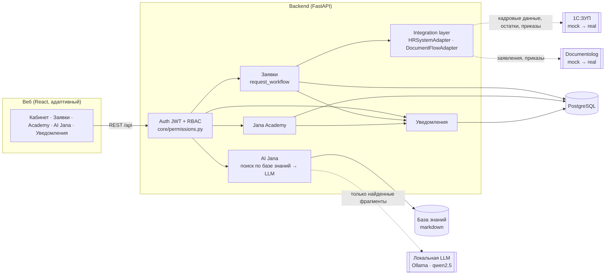
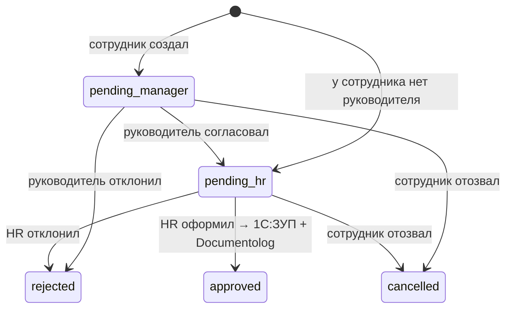

# Архитектура JanaMen

## Принципы

1. **Права проверяются на бэкенде.** Все правила «кто что видит» собраны в `backend/app/core/permissions.py`. Фронт скрывает недоступные разделы только ради удобства. Прямой запрос к API с чужим id возвращает 403, это покрыто тестами.
2. **Кадровые данные только для чтения.** Таблица `employees` — зеркало 1С:ЗУП. В API нет методов для её изменения. Изменения идут только через заявку → HR → адаптер 1С.
3. **Интеграции через адаптеры.** Платформа зависит от интерфейсов `HRSystemAdapter` и `DocumentFlowAdapter` (`app/integrations/base.py`). Чтобы подключить реальные системы, нужно написать класс с тем же интерфейсом и переключить `HR_SYSTEM_PROVIDER=real` / `DOCFLOW_PROVIDER=real`. Бизнес-логика при этом не меняется.
4. **AI Jana не выдумывает.** Конвейер: поиск по базе знаний с учётом роли → если ничего не найдено, отказ без вызова модели → иначе локальная LLM пересказывает **только найденные фрагменты** → проверка ответа (маркер «НЕТ_ОТВЕТА», числа должны встречаться в контексте) → источник. Если LLM недоступна, ассистент отдаёт цитату из базы. Модель работает локально в Docker (Ollama), так что данные не уходят во внешние сервисы.
   Детали: Ответ строится только из найденного фрагмента базы знаний и всегда содержит источник. Если совпадение ниже порога, ассистент честно отказывает и предлагает эскалацию в HR. Ассистент не получает персональные данные: ему передаются только вопрос и роль. Документы базы знаний фильтруются по ролям.
5. **Локализация.** Строки интерфейса лежат в словарях `frontend/src/i18n` (RU/KZ).

## Жизненный цикл заявки

Каждый переход пишется в `request_events` (история) и создаёт уведомление.

## Подключение реальных систем (план)

| Система | Что берём / отдаём | Как |
|---|---|---|
| 1С:ЗУП | Справочник сотрудников, оргструктура, остатки отпусков; проведение приказов на отпуск и начислений аванса | HTTP-сервис 1С / OData, периодическая синхронизация в `employees` и вызовы при оформлении |
| Documentolog | Регистрация заявлений и приказов, статусы согласования | REST API, `external_doc_id` в заявке, webhook на смену статуса |
| SSO (будущее) | Корпоративный вход | OIDC вместо локального логина, роли из AD/1С |
